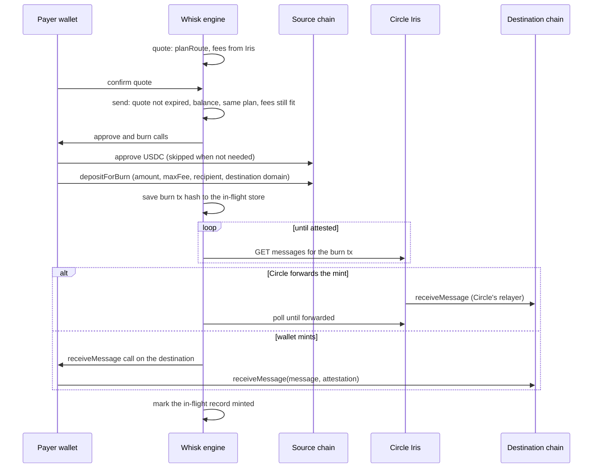

Every Whisk transfer is either a same-chain USDC transfer or a Circle CCTP V2 bridge: burn on the source chain, wait for Circle's attestation, mint on the destination. `planRoute` shows the plan Whisk will follow for a pair of chains before anything is signed.

```ts
import { planRoute } from "@usewhisk/core";

const plan = planRoute({
  source: "Base",
  destination: "Arc",
  useForwarder: true,
});

console.log(plan.network, plan.speed, plan.mint, plan.etaSeconds);
// "mainnet" "fast" { kind: "forwarder" } { min: 8, max: 8 }
```

## Same chain or bridge

When the source and destination chain are the same, the route is a `send`: one USDC transfer from the payer to the recipient, signed by the payer's wallet. There is no burn, no attestation and no protocol fee. On Solana, Whisk also creates the recipient's USDC account in the same transaction if it is missing, and the payer pays its rent.

When they differ, the route is a `bridge`, and `planRoute` returns a `RoutePlan`:

| Field              | What it means                                                                                                                              |
| ------------------ | ------------------------------------------------------------------------------------------------------------------------------------------ |
| `network`          | `"mainnet"` or `"testnet"`, taken from the source chain. A source and destination on different networks throw `NetworkMismatchError`.      |
| `speed`            | `"fast"` when the source supports Fast Transfer, otherwise `"standard"`.                                                                   |
| `mint`             | `{ kind: "forwarder" }` when Circle submits the mint, or `{ kind: "adapter", ecosystem }` when a wallet on the destination has to sign it. |
| `requiredAdapters` | The wallet ecosystems the transfer needs: the source, plus the destination when it is not the same ecosystem and Circle does not forward.  |
| `etaSeconds`       | Circle's published attestation time for the source at that speed. The mint adds a few seconds.                                             |

Pass `connected` (the ecosystems with a wallet connected) and `planRoute` also throws `RouteUnavailableError` when a required wallet is missing. `engine.quote` does this for you from the adapters you give it.

## The transfer, end to end



1. **Quote.** `engine.quote` plans the route, reads Circle's fees from Iris and returns a `Quote` that holds the exact subunits the payer will sign. See [quotes and fees](/concepts/quotes-and-fees).
2. **Checks before signing.** `engine.send` refuses an expired quote, an EVM payer whose USDC cannot cover the quote, a route whose plan changed, and fees that rose past the quote. Each of these throws before the wallet is asked for anything.
3. **Approve.** On EVM sources the payer approves Circle's `TokenMessengerV2` for exactly the burn amount, or `TokenMessengerWithFees` for the burn plus the shown fee on the upfront fee path. Whisk does not reuse an existing allowance. Solana burns need no approval. On Stellar the wallet gets the approval and the burn in one request, and on Starknet they ride in one multicall. On those three sources the `approve` step is `noop`.
4. **Burn.** The payer's wallet signs `depositForBurn` with the quote's `burnAmount` and `maxFee`. The USDC leaves the payer's wallet here. The engine records the burn hash the moment the wallet returns it, before waiting for a receipt, so a closed tab can still be [recovered](/concepts/recovery).
5. **Attestation.** The engine polls Circle's Iris API until the burn is attested. Iris is chosen from the source chain's network: `iris-api.circle.com` for mainnet, `iris-api-sandbox.circle.com` for testnet.
6. **Mint.** Circle's forwarder submits the mint, or the engine asks a wallet on the destination to sign `receiveMessage` with the attested message.

## Who mints

Circle's forwarder relays the mint only when all of these hold:

- `useForwarder` is on (the default);
- the source is an EVM chain or Solana;
- the destination is an EVM chain that supports forwarding.

Everything else needs a wallet on the destination, passed as `destinationAdapter` to `quote` and `send`:

- bridges into Solana, Stellar or Starknet;
- bridges out of Stellar or Starknet, which Iris does not forward;
- bridges into EVM chains without forwarding: Injective, Morph, Pharos, Cronos, Plasma and X Layer, and their testnets.

For an EVM to EVM transfer that Circle does not forward, the source wallet switches chain and signs the mint if you pass no `destinationAdapter`.

If Circle's forwarder reports `FAILED`, the transfer does not stop there: `send` and `resume` fall back to a mint signed by the destination wallet. If the forwarder is still pending when the polling window ends, `send` returns a failure and the transfer stays in the in-flight store to resume later.

```ts
import { getChain, planRoute } from "@usewhisk/core";

getChain("Base").capabilities.fastSource; // true
getChain("Arc").capabilities.fastSource; // false

const plan = planRoute({
  source: "Solana",
  destination: "Starknet",
  connected: ["solana"],
  useForwarder: true,
});
// Throws RouteUnavailableError, reason "destination_adapter_required":
// Starknet needs a Starknet wallet to sign the mint.
```

## Fast and Standard

CCTP V2 has two speeds. A Fast burn is attested within seconds, before the source chain is final, for a small protocol fee. A Standard burn waits for finality. On Ethereum and the OP-stack chains that is 15 to 19 minutes; on chains with fast finality, such as Arc, it is seconds.

Whisk picks Fast whenever the source chain supports it. The registry flag `capabilities.fastSource` on each chain says which ones do:

| Fast sources                                                                                                                  | Standard only                                                                                             |
| ----------------------------------------------------------------------------------------------------------------------------- | --------------------------------------------------------------------------------------------------------- |
| Ethereum, OP Mainnet, Arbitrum, Base, Unichain, Linea, Codex, World Chain, Ink, Plume, EDGE, Morph, X Layer, Solana, Starknet | Avalanche, Polygon PoS, Sonic, Monad, Sei, XDC, HyperEVM, Arc, Injective, Pharos, Cronos, Plasma, Stellar |

The testnet of each chain has the same flag. The speed depends only on the source: a transfer into Ethereum from Base is Fast, one from Arc into Base is Standard.

Circle caps how much USDC can be in Fast transfers at once. When the burn is larger than Circle's remaining Fast allowance, Whisk plans the transfer as Standard before quoting, so the payer does not pay a Fast fee for a transfer Circle would attest as Standard anyway, and the ETA shown is the Standard one.

## The step model

`send`, `resume` and `resumeFromTx` report progress as `Step` objects, through the `onStep` listener and on the result.

```ts
import { createWhisk, type EvmAdapter } from "@usewhisk/core";

declare const adapter: EvmAdapter;
declare function saveBurnHash(txHash: string): void;

const engine = createWhisk({ chains: ["Base_Sepolia", "Arc_Testnet"] });

const recipient = await engine.resolve(
  "0x742d35Cc6634C0532925a3b844Bc9e7595f0bEb1",
  "Arc_Testnet",
);
const quote = await engine.quote({
  sourceChain: "Base_Sepolia",
  destinationChain: "Arc_Testnet",
  recipient,
  amount: "25",
  adapter,
});

const result = await engine.send(
  { quote, adapter },
  {
    onBurnSubmitted: (txHash) => saveBurnHash(txHash),
    onStep: (step) => console.log(step.name, step.state, step.txHash),
  },
);
```

A bridge reports four steps, in order: `approve`, `burn`, `fetchAttestation`, `mint`. An EVM or Solana same-chain send reports `approve` (always `noop`) and `transfer`.

| `StepName`         | What it covers                                                             |
| ------------------ | -------------------------------------------------------------------------- |
| `approve`          | The USDC approval for the burn. `noop` where none is needed.               |
| `transfer`         | A same-chain USDC transfer.                                                |
| `burn`             | The CCTP burn on the source chain. USDC leaves the payer's wallet here.    |
| `fetchAttestation` | Waiting for Circle's Iris to attest the burn.                              |
| `mint`             | `receiveMessage` on the destination, by Circle's forwarder or by a wallet. |

Each step has a `StepState`: `pending`, `success`, `error` or `noop`. The first `pending` step is the active one. A step can also carry:

- `txHash` and `explorerUrl` for the transaction it covers;
- `errorMessage` and `errorCategory` when it failed (see [errors](/concepts/errors));
- `forwarded: true` on a `mint` that Circle's forwarder submitted.

The widget's `StepRail` renders these steps with the labels "Approve USDC", "Transfer", "Burn on source chain", "Confirm attestation" and "Mint on destination". Pass `labels` to change them.

<Note>
  A same-chain send on Stellar or Starknet reports its transfer under the `burn`
  step name, with `approve`, `fetchAttestation` and `mint` as `noop`. No burn
  happens; it is a plain USDC transfer. Match on `transfer` and `burn` both if
  you label same-chain progress yourself.
</Note>

## Related

<CardGroup cols={2}>
  <Card title="Quotes and fees" href="/concepts/quotes-and-fees">
    What the payer pays, what the recipient gets, and why a quote can be
    refused.
  </Card>
  <Card title="Recovery" href="/concepts/recovery">
    How a transfer finishes after a closed tab or a failed mint.
  </Card>
  <Card title="Fund safety" href="/concepts/fund-safety">
    The checks that run before the burn, and the gaps.
  </Card>
  <Card title="Chains" href="/chains">
    Every supported chain and its capabilities.
  </Card>
</CardGroup>
